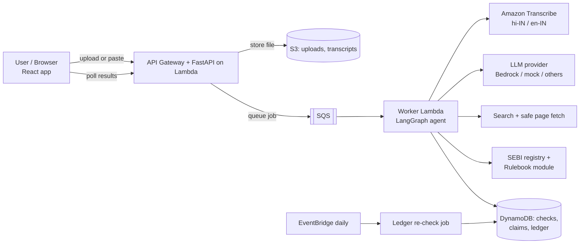

# PaperTrail

**Every money claim leaves a trail. PaperTrail follows it.**

PaperTrail checks what Indian finance creators ("finfluencers") say. Upload a video, audio clip,
post or article. PaperTrail pulls out every checkable claim, finds evidence for and against it,
and gives a sourced verdict for each claim in plain language. It also checks whether the creator is
registered with SEBI, and it flags statements that official SEBI rules and guidance treat as
red flags, such as "guaranteed returns".

> **Status:** 🚧 In progress. Parts 1–2 of 14 complete (foundation, LLM layer, claim extraction). See the [roadmap](docs/ROADMAP.md).
> Live demo link: *coming after Part 10*.

> **Not financial advice.** PaperTrail assesses *claims*, never *people*. A verdict of "no
> evidence found" means exactly that, and nothing more. SEBI registration does not mean SEBI
> endorses or guarantees anyone's advice.

---

## What it does, in plain English

| Step | What happens | Why it matters to you |
|---|---|---|
| 1. **Listen** | Turns the video or audio into text (Hindi, English, Hinglish). | You don't have to rewatch a 20-minute video. |
| 2. **Find claims** | Picks out statements that can be checked, e.g. *"This stock gave 300% in a year."* | Opinions are left alone. Only facts get checked. |
| 3. **Gather evidence** | Searches trustworthy sources and rates each one for reliability, recency and relevance. | You see *where* the answer comes from. |
| 4. **Give a verdict** | Each claim is marked **Supported**, **Contradicted**, **Misleading** or **Not verifiable**, with reasons. | You can see *why*, and what couldn't be checked. |
| 5. **Check the rulebook** | Is the creator SEBI-registered? Do they promise things SEBI rules warn about? | Each flag links to the official SEBI source. |
| 6. **Keep receipts** | Past stock calls are re-checked against real prices over time (the Claim Ledger). | Track records, not hype. |

A full glossary lives in [docs/PLAIN_ENGLISH.md](docs/PLAIN_ENGLISH.md).

## Architecture (target)



The browser never waits on the AI: the API queues a job, a worker runs the steps, and the app
checks back for results. Design decisions are recorded in [docs/adr/](docs/adr/).

## Quick start (local, no keys, no AWS)

```bash
git clone https://github.com/Anushkajoshii/PaperTrail.git
cd PaperTrail
make install   # uv sync + pre-commit hooks
make test
```

Try claim extraction on a sample (works offline):

```bash
uv run python -m papertrail.agent.extract examples/hinglish_reel.txt
```

By default the AI runs in **mock mode**: deterministic and offline, so tests and CI need no
API keys. Real providers (Bedrock, Anthropic, OpenAI-compatible, Ollama) are switched on through
`.env`. See [.env.example](.env.example).

## Tech stack

| Layer | Tool |
|---|---|
| Frontend | React + Vite + Tailwind (Vercel) |
| API | FastAPI on AWS Lambda (Mangum) behind API Gateway |
| Jobs | SQS + worker Lambda (container image in ECR) |
| Agent | LangGraph |
| LLM | Pluggable: Amazon Bedrock in production, offline mock for development |
| Structured output | Pydantic |
| Speech to text | Amazon Transcribe (hi-IN, en-IN) |
| Search | Tavily + trafilatura (injection-safe page text) |
| Regulatory | SEBI registered intermediaries list + curated SEBI rulebook sources |
| Storage | DynamoDB, S3 |
| Tracing | Langfuse |
| Infra / CI | Terraform, GitHub Actions with OIDC (no stored AWS keys) |

## Results

*Filled in from real evaluation runs in Parts 6 and 13. No numbers are shown until they are
measured.*

| Metric | Value |
|---|---|
| Claim-extraction recall | - |
| Verdict accuracy | - |
| Citation faithfulness | - |
| SEBI lookup accuracy | - |
| p50 / p95 latency | - |
| Cost per check | - |

## Known limitations

See [docs/LIMITATIONS.md](docs/LIMITATIONS.md). In short, PaperTrail cannot read minds or
intent, cannot prove someone broke the law, and depends on the sources it can reach.

## Project docs

- [Roadmap and progress](docs/ROADMAP.md)
- [Plain-English guide and glossary](docs/PLAIN_ENGLISH.md)
- [Development guide](docs/DEVELOPMENT.md)
- [Limitations](docs/LIMITATIONS.md)
- [Architecture Decision Records](docs/adr/)

## Licence

MIT. See [LICENSE](LICENSE).
