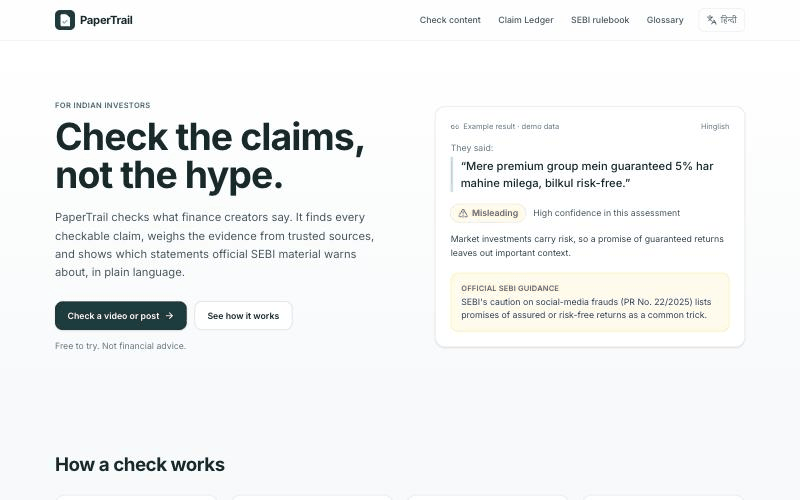
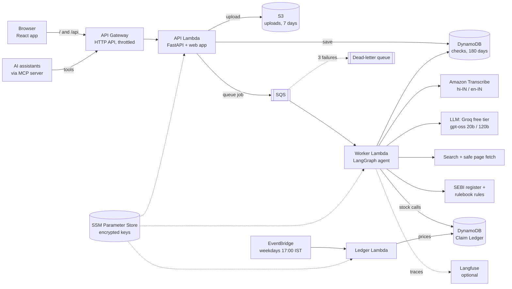
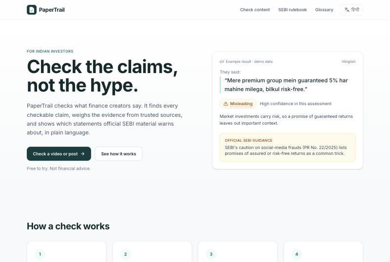
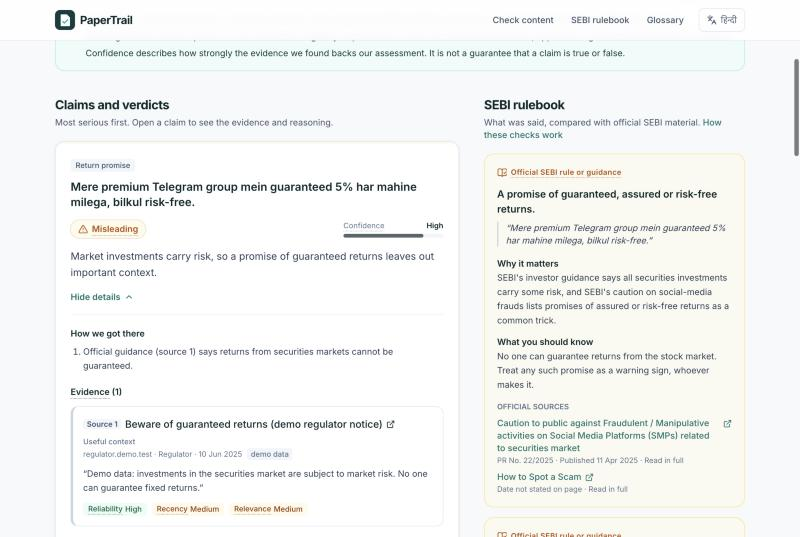
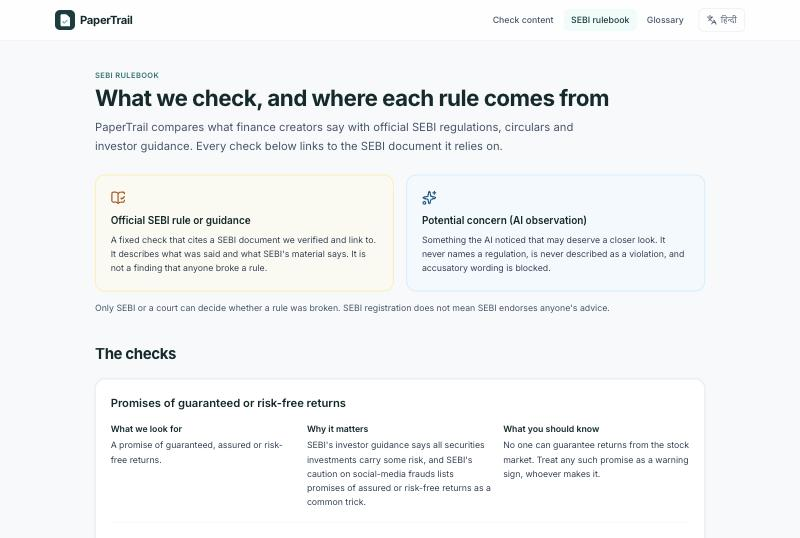
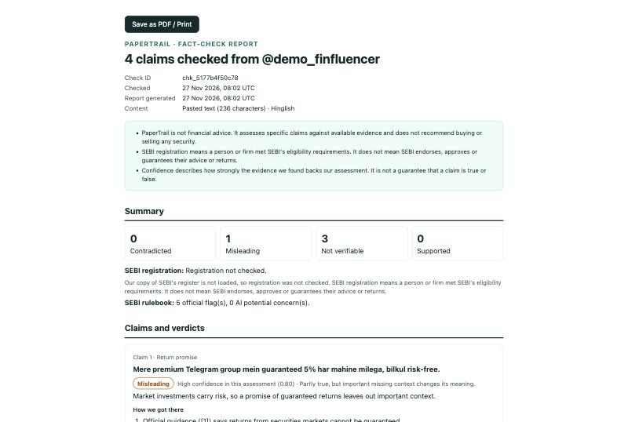
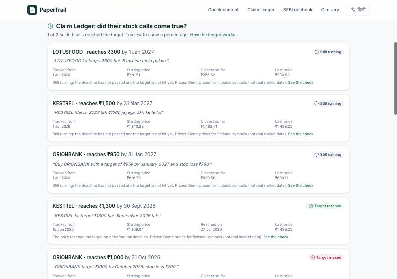
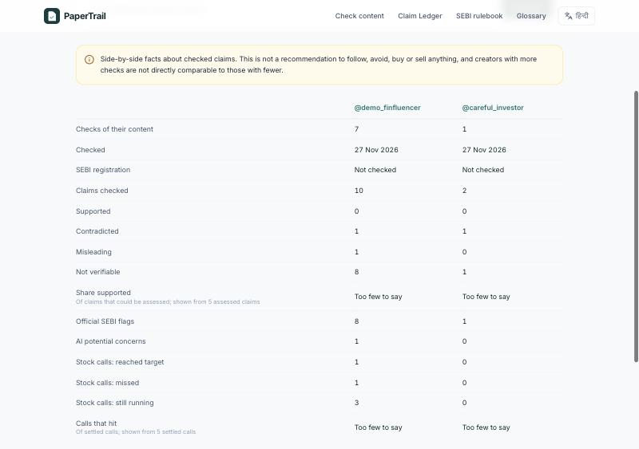

# PaperTrail

**Every money claim leaves a trail. PaperTrail follows it.**

PaperTrail checks what Indian finance creators ("finfluencers") say. Upload a video, audio clip,
post or article. PaperTrail pulls out every checkable claim, finds evidence for and against it,
and gives a sourced verdict for each claim in plain language. It also checks whether the creator is
registered with SEBI, and it flags statements that official SEBI rules and guidance treat as
red flags, such as "guaranteed returns".

> **Live demo:** [w5fnwkmfr6.execute-api.ap-southeast-2.amazonaws.com](https://w5fnwkmfr6.execute-api.ap-southeast-2.amazonaws.com/) · API docs: [/api/docs](https://w5fnwkmfr6.execute-api.ap-southeast-2.amazonaws.com/api/docs)
> **Status:** All 14 parts complete. The full pipeline (claims → evidence → verdicts → SEBI rulebook → report) runs on AWS Lambda with free open models on Groq. See the [roadmap](docs/ROADMAP.md).
> The demo uses a labelled offline evidence set, so web results are illustrative.

> **Not financial advice.** PaperTrail assesses *claims*, never *people*. A verdict of "no
> evidence found" means exactly that, and nothing more. SEBI registration does not mean SEBI
> endorses or guarantees anyone's advice.

---



*Recorded on the live site. Evidence in the demo comes from a labelled offline set, so the web results are illustrative.*

## What it does, in plain English

| Step | What happens | Why it matters to you |
|---|---|---|
| 1. **Listen** | Turns the video or audio into text (Hindi, English, Hinglish). | You don't have to rewatch a 20-minute video. |
| 2. **Find claims** | Picks out statements that can be checked, e.g. *"This stock gave 300% in a year."* | Opinions are left alone. Only facts get checked. |
| 3. **Gather evidence** | Searches trustworthy sources and rates each one for reliability, recency and relevance. | You see *where* the answer comes from. |
| 4. **Give a verdict** | Each claim is marked **Supported**, **Contradicted**, **Misleading** or **Not verifiable**, with reasons. | You can see *why*, and what couldn't be checked. |
| 5. **Check the rulebook** | Is the creator SEBI-registered? Do they promise things SEBI rules warn about? | Each flag links to the official SEBI source. |
| 6. **Download the report** | A source-cited report you can save as PDF, download, or share on WhatsApp. | Keep proof, and share it with family. |
| 7. **Keep receipts** | Stock calls are re-checked against real prices after their deadline (the [Claim Ledger](docs/LEDGER.md)). Creator pages show track records and a red-flag timeline, and up to three creators can be compared. | Track records, not hype, and no single score that labels a person. |

A full glossary lives in [docs/PLAIN_ENGLISH.md](docs/PLAIN_ENGLISH.md).

## Architecture



The browser never waits on the AI: the API queues a job, a worker runs the agent, and the app
checks back for results. Everything is pay-per-use (about $0 when idle) and deployed by GitHub
Actions over OIDC with no stored AWS keys. Design decisions are recorded in
[docs/adr/](docs/adr/). The deployment guide and cost table are in [docs/DEPLOY.md](docs/DEPLOY.md).

## Quick start (local, no keys, no AWS)

```bash
git clone https://github.com/Anushkajoshii/PaperTrail.git
cd PaperTrail
make install   # uv sync + pre-commit hooks
make test
```

Run a complete check on a sample (works offline, about one second):

```bash
make demo                                   # Hinglish finfluencer reel
make demo FILE=examples/english_post.txt    # English post
```

The report shows each claim with its verdict, confidence and reasons, the evidence for and
against, what could not be verified, and every SEBI rulebook flag with its official source.

Run the API (interactive docs at http://localhost:8000/docs):

```bash
make dev                      # one process, checks run in the background
docker compose up --build     # API + worker, like the cloud setup
```

See [docs/API.md](docs/API.md) for endpoints and examples.

Run the web app (with the API running):

```bash
cd web && npm install && npm run dev     # http://localhost:5173
```

| Landing page | Claim with evidence | SEBI rulebook | Downloadable report |
|---|---|---|---|
|  |  |  |  |

| Claim Ledger on a creator page (demo prices, fictional symbols) | Creators side by side |
|---|---|
|  |  |

By default the AI runs in **mock mode**: deterministic and offline, so tests and CI need no
API keys. Real providers are switched on through `.env` (see [.env.example](.env.example)):
**Groq** (free tier, no card), Anthropic, Amazon Bedrock, any OpenAI-compatible API, or Ollama
on your laptop.

## Deploy to AWS

`make plan` previews and `make deploy` ships it: Terraform for Lambda, API Gateway, DynamoDB,
SQS, S3, ECR and SSM, plus GitHub OIDC deploys with no stored AWS keys. It is designed to cost
about $0 when idle. Step by step, with a cost table: [docs/DEPLOY.md](docs/DEPLOY.md).

## Tech stack

| Layer | Tool |
|---|---|
| Frontend | React + Vite + Tailwind, served by the API Lambda (one URL, no CORS) |
| API | FastAPI on AWS Lambda (Mangum) behind API Gateway |
| Jobs | SQS + worker Lambda (container image in ECR) |
| Agent | LangGraph |
| LLM | Pluggable: Groq free tier (gpt-oss) deployed, Claude via Anthropic or Bedrock, offline mock for tests |
| Structured output | Pydantic |
| Speech to text | Amazon Transcribe (hi-IN, en-IN) |
| Search | Tavily + trafilatura (injection-safe page text) |
| Regulatory | SEBI registered intermediaries list + curated SEBI rulebook sources |
| Storage | DynamoDB, S3 |
| Tracing | Langfuse (optional): one trace per check with every step, AI call and retry; [docs/OBSERVABILITY.md](docs/OBSERVABILITY.md) |
| Secrets | SSM Parameter Store (never in Terraform state or GitHub) |
| Infra / CI | Terraform (S3 remote state), GitHub Actions with OIDC (no stored AWS keys) |

## Results

*Numbers appear here only once measured. Speed and cost below come from the live deployment on
27 Nov 2026 (10 real checks of the sample posts in English, Hinglish and Hindi, two at a time, AI
from Groq's free tier). Accuracy comes from the golden set v2 (95 verdicts, 55 claims in 20
transcripts, English, Hindi and Hinglish) with `openai/gpt-oss-120b`, the judge used in
production. It is a small set written by one person, so treat the numbers as indicative.*
How we evaluate, and what every metric means: [docs/EVALUATION.md](docs/EVALUATION.md). The
offline regression baseline (rule-based mock, **not** model accuracy) is in
[evals/reports/mock-full.md](evals/reports/mock-full.md). Models side by side:
[evals/reports/model-comparison.md](evals/reports/model-comparison.md).

| Metric | Value |
|---|---|
| Claim-extraction recall | 98% (86% with the right claim type) |
| Verdict accuracy | 83% (macro-F1 0.80; weakest on "misleading", F1 0.47) |
| Citation validity | 70% of supported/contradicted verdicts cite only the right kind of passage |
| SEBI red-flag rules | F1 1.00 on 52 sentences (not a held-out set: the rules were fixed on it) |
| SEBI registration lookup | Not measured |
| p50 / p95 time per check | 9.9 s / 37.2 s (the slow tail is free-tier rate limiting) |
| Cost per check | $0 on Groq's free tier (about 6,000 tokens and 4.6 AI calls per check) |

## Known limitations

See [docs/LIMITATIONS.md](docs/LIMITATIONS.md). In short, PaperTrail cannot read minds or
intent, cannot prove someone broke the law, and depends on the sources it can reach.

## Project docs

- [Roadmap and progress](docs/ROADMAP.md)
- [Plain-English guide and glossary](docs/PLAIN_ENGLISH.md)
- [Development guide](docs/DEVELOPMENT.md)
- [API reference](docs/API.md) and [OpenAPI spec](docs/openapi.json)
- [Evaluation: golden sets, metrics, regression gate](docs/EVALUATION.md)
- [SEBI rulebook: every check and its official source](docs/SEBI_RULEBOOK.md)
- [Limitations](docs/LIMITATIONS.md)
- [Architecture Decision Records](docs/adr/)

## Licence

MIT. See [LICENSE](LICENSE).

© 2026 Anushka Joshi
