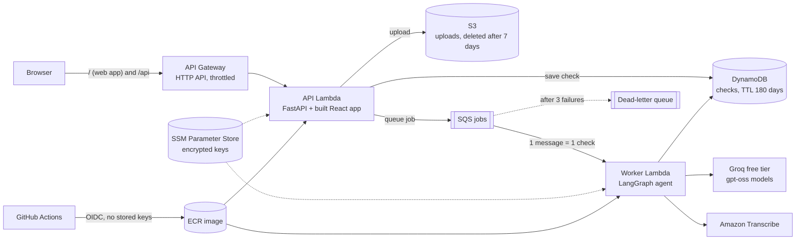

# Deploying PaperTrail to AWS

PaperTrail runs on AWS as two Lambda functions behind one URL. Everything is pay-per-use, so an
idle deployment costs close to nothing, and the free Groq tier provides the AI.



## What it costs

On the AWS Free plan nothing is charged to a card: usage comes out of the free credits, and the
account can't be billed unless you choose to upgrade. Estimated monthly use for a portfolio demo
(a few hundred checks):

| Service | What it does | Expected monthly |
|---|---|---|
| Lambda (arm64) | API and worker | ~$0 (well inside the free allowance) |
| API Gateway HTTP API | The public URL | ~$0.01 |
| DynamoDB on-demand | Stores checks | ~$0.01 |
| SQS | Job queue | ~$0 |
| S3 | Uploads (auto-deleted after 7 days) and Terraform state | ~$0.01 |
| ECR | Container image (last 5 kept) | ~$0.05 |
| CloudWatch Logs | Logs kept 14 days | ~$0.01 |
| SSM Parameter Store | Encrypted keys (standard tier) | $0 |
| AWS Budgets | Email alerts | $0 (first two budgets) |
| Groq | AI models | $0 (free tier) |

Nothing runs all the time (no servers, NAT gateways or load balancers), so idle cost stays near
zero. API Gateway throttling (10 requests a second) and a worker concurrency of 2 cap the worst
case.

## One-time setup

You need the AWS CLI (signed in with `aws login --profile portfolio`), Docker Desktop and
Terraform.

1. **Create the Terraform state bucket** (stores what Terraform created):

   ```bash
   cd infra/bootstrap
   AWS_PROFILE=portfolio terraform init
   AWS_PROFILE=portfolio terraform apply
   terraform output -raw backend_config > ../backend.hcl   # git-ignored
   cd ../..
   ```

2. **Set your budget email** (optional but recommended):

   ```bash
   cp infra/terraform.tfvars.example infra/terraform.tfvars   # git-ignored; edit the email
   ```

3. **Preview** what will be created. This creates nothing:

   ```bash
   make plan
   ```

4. **Deploy.** This builds the image, pushes it, and shows the plan again. Type `yes` to
   confirm:

   ```bash
   make deploy
   ```

   The last line prints the live URL. The API docs are at `<url>/api/docs`.

5. **Store the Groq key** in AWS (read from your local `.env`, and never printed):

   ```bash
   AWS_PROFILE=portfolio uv run python scripts/push_secrets.py
   ```

   New Lambda instances pick it up automatically. To apply it at once, run `make deploy` again.

6. **Turn on automatic deploys from GitHub.** In the repository, go to **Settings → Secrets and
   variables → Actions → Variables** and add:
   - `AWS_DEPLOY_ROLE_ARN`: the output of `terraform -chdir=infra output -raw github_deploy_role_arn`
   - `APP_URL`: the live URL

   From then on, every merge to `main` that passes CI is built and deployed automatically. The
   GitHub workflow gets short-lived AWS credentials through OIDC and can only push the image
   and update the two functions.

## Everyday commands

| Command | What it does |
|---|---|
| `make plan` | Show what would change in AWS (creates nothing) |
| `make deploy` | Build, push and apply (asks you to confirm) |
| `make destroy` | Remove every PaperTrail resource (asks you to confirm) |

## Switching the AI provider

`llm_provider` in `infra/terraform.tfvars` chooses the model backend:

- `groq` (default): free open models. The key lives in SSM.
- `mock`: no AI calls. Useful if the Groq key is missing.
- `bedrock`: Claude on Amazon Bedrock, once AWS grants the account access to Anthropic models.
  The worker role then also needs `bedrock:InvokeModel`.

## Troubleshooting

- **A check stays "queued":** look at the worker logs in CloudWatch
  (`/aws/lambda/papertrail-prod-worker`) and the dead-letter queue (`jobs_dlq_url` output).
- **"Set PAPERTRAIL_GROQ_API_KEY":** the key isn't in SSM yet (step 5).
- **Uploads over 4 MB are rejected:** Lambda limits request size. Use subtitles (.srt/.vtt) or a
  shorter clip.
- **Region:** the Free plan project is fixed to Sydney (`ap-southeast-2`). Everything,
  including the Terraform state, lives there.
