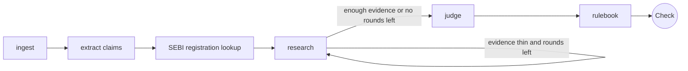

# ADR-010: A LangGraph state machine with an evidence loop and a step guard

- **Status:** Accepted
- **Date:** 2026-11-26

## Context

A check has several stages (read content, find claims, check registration, gather evidence,
judge, apply the rulebook). One stage, research, sometimes needs a second attempt. It has to be:
testable offline, observable (progress for the UI, cost per check), safe (never loops forever,
never shows half a result), and easy to explain in a diagram.

## Decision

- **LangGraph `StateGraph`** with one node per stage and a conditional edge for the evidence loop.
  A graph makes the control flow explicit and inspectable (`get_graph()`), and leaves room for
  parallel research and checkpointing later.
- **Code chooses the actions, not the LLM.** The LLM extracts and judges, but the graph decides
  which tools run, and research picks URLs in code. Prompt-injected page text cannot trigger tools.
- **Evidence loop.** Claims without clearly relevant evidence (relevance < 0.45) get a broader
  second search round, up to `PAPERTRAIL_MAX_SEARCH_ROUNDS` (default 2).
- **Max-steps guard.** Every node counts a step. Going over `PAPERTRAIL_MAX_AGENT_STEPS` aborts,
  and LangGraph's recursion limit is a second backstop.
- **All-or-nothing results.** Any fatal error gives `status=failed` with a user-safe message
  and no partial verdicts. Non-fatal problems (a site that blocked us, an AI-suggested claim
  dropped as ungrounded) are recorded in `metrics.notes`.
- **Dependencies are injected** (`AgentDeps`: LLM provider, search, fetcher, register,
  transcriber), so tests run the real graph with mocks and the cloud worker can swap in AWS
  services.
- **Metrics on every check:** LLM calls, tokens, estimated cost, duration, steps, search rounds,
  pages fetched and prompt versions. These feed the eval report and the "cost per check" number.

## Consequences

- ✅ The whole pipeline runs offline in about a second, so CI exercises it on every PR.
- ✅ The diagram in this ADR is the code's actual structure.
- ➖ Claims are processed one after another for now. Parallel research is an easy later change
  inside the research node.
- ➖ LangGraph adds a dependency for a mostly linear flow. We accept that for the loop, the
  inspectability, and the interview value of a standard agent framework.

## In plain English

PaperTrail works like a checklist the computer follows in order. If it can't find good evidence
the first time, it tries one more, broader search, but it has a hard limit on how many steps it
can take, and if anything goes wrong it shows an error rather than half an answer.
